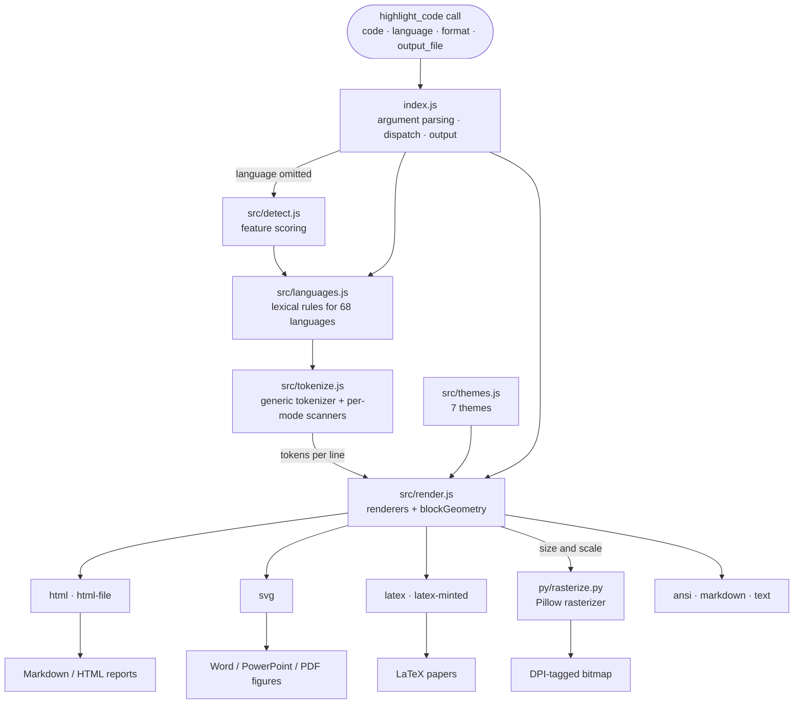
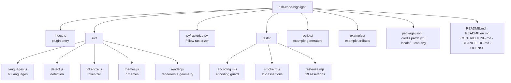

# dsh-code-highlight

**English** | [中文](README.md)

[](LICENSE)
[](package.json)
[](#install)

A DeepSeek Harness (DSH) plugin that highlights code for **report-style documents**. It registers a
`highlight_code` tool that turns a snippet into a colored artifact ready for Markdown / HTML, Word,
PowerPoint, PDF and LaTeX.

<p align="center">
  
</p>

## Features

- **68 languages** — resolved by id, alias or file extension; detected from the content when `language` is omitted, and rendered as plain text when detection is not confident.
- **10 formats** — `html`, `html-file`, `svg`, `svg-png`, `png`, `latex`, `latex-minted`, `markdown`, `ansi`, `text`.
- **7 themes** — `paper-light` (document-oriented), `github-dark`, `github-light`, `one-dark`, `monokai`, `solarized-light`, `solarized-dark`, plus `auto`.
- **One geometry for vector and raster** — the SVG and the PNG come from the same layout model, so their physical size and per-cell positions match.
- **Document-oriented layout** — `width_in`, `dpi`, `font_size_pt`, `line_height`, `show_title` produce a figure that fits a page column directly.
- **Writes files** — pass `output_file` and the artifact is written to disk; the path comes back instead of a long body.
- **No browser, no Office** — the PNG is drawn by a bundled Pillow rasterizer, with CJK and ASCII aligned on a fixed-advance grid.
- **No runtime npm dependencies** — tokenizer and renderers are self-contained and work offline.

## Install

### Install from GitHub (CLI)

```bash
dsh plugin --profile desktop add github:scientificmaniac/dsh-code-highlight
```

- Replace `--profile desktop` with your profile name: DSH Desktop uses `desktop`, the Web build usually `web`.
- Quit the Desktop app completely before running it: `dsh plugin` takes the profile's write lock exclusively.
- `dsh plugin --profile <p> <args>` forwards its arguments to pnpm unchanged, so a pinned tag works too:
  `... add github:scientificmaniac/dsh-code-highlight#v1.0.0`.

### Install inside a DSH session

Ask the agent to call `plugin_manager`:

```
action: install_bundle
target: <absolute path to this repository>
```

Either path inserts the plugin row from `cordis.patch.yml`, and `highlight_code` becomes available to
every session in that profile. Restart DSH after changing plugin sources: a running session keeps the
module it loaded.

### As a library

```bash
git clone https://github.com/scientificmaniac/dsh-code-highlight.git
cd dsh-code-highlight
npm test
```

`index.js` exports the DSH plugin surface (`apply`, `inject`, `name`). To use only the rendering
pipeline, import the modules directly:

```js
import { resolveLanguage } from 'dsh-code-highlight/src/languages.js';
import { tokenizeLines } from 'dsh-code-highlight/src/tokenize.js';
import { resolveTheme } from 'dsh-code-highlight/src/themes.js';
import { renderHtml } from 'dsh-code-highlight/src/render.js';
```

## Usage

| Parameter | Description |
| --- | --- |
| `code` (required) | The code to highlight. Fenced block markers and a trailing newline are tolerated. |
| `language` | Language id, alias or extension, such as `python`, `py`, `ts`, `c++`, `bash`, `sql`, `latex`. Omit to detect it. |
| `format` | Output format, `html` by default. |
| `theme` | Theme id or `auto`. `paper-light` suits printed reports. |
| `dark` | Light/dark preference used only when `theme` is `auto`. Defaults to dark. |
| `title` | Block label, typically the file name or the snippet's purpose. |
| `show_title` | Show `title`; defaults to true. Set false to drop the file name entirely. |
| `document_title` | Heading for `html-file` only; omitted by default so a file name never becomes a document heading. |
| `line_numbers` | Show a line-number gutter; defaults to true. |
| `start_line` | Number given to the first line; defaults to 1. |
| `highlight_lines` | Lines to emphasize, for example `"3,7-9"`. |
| `font_size` | Code font size in CSS pixels; defaults to 13. |
| `font_size_pt` | Code font size in points, overriding `font_size` (1 pt = 4/3 px). |
| `line_height` | Line height as a multiple of the font size; defaults to 1.5. |
| `tab_size` | Spaces per tab; defaults to 4. |
| `canvas` | Target canvas as `WIDTHxHEIGHT`, e.g. `"960x540"`; the SVG becomes a full page-sized image ready for `univer_compile_svg`. |
| `width_in` | Physical width in inches, e.g. `6.3`. PNG pixels become `width_in × dpi`; SVG gets a matching `width="…in"`. |
| `dpi` | Raster resolution; defaults to 300 and is recorded in the PNG so Word sizes it correctly. |
| `output_file` | Write the artifact here and return the path; relative paths resolve against the session workspace. Required for `png` and `svg-png`. |
| `overwrite` | Allow replacing an existing file; defaults to false. |
| `mono_font` | Font file for ASCII glyphs when rasterizing, e.g. `consola.ttf`. |
| `cjk_font` | Font file for CJK and other wide glyphs when rasterizing, e.g. `msyh.ttc`. |

### Formats and destinations

| `format` | Artifact | Typical destination |
| --- | --- | --- |
| `html` | Inline-styled HTML fragment | Markdown or HTML reports, email, rich-text fields |
| `html-file` | Complete standalone HTML document | Open in a browser, print to PDF |
| `svg` | Vector code figure (optionally sized by `width_in`) | Word / PowerPoint / PDF figures, or `univer_compile_svg` |
| `svg-png` | The `.svg` and a matching `.png` | Documents that want a scalable figure plus a bitmap fallback |
| `png` | Pillow raster with DPI metadata | Editors without SVG support, PDF layout, quick preview |
| `latex` | `listings` environment | `.tex` reports (works with pdfLaTeX and XeLaTeX, no shell-escape) |
| `latex-minted` | `minted` environment | `.tex` that can run with `-shell-escape` |
| `markdown` | Fenced code block | Renderers that highlight on their own |
| `ansi` | 24-bit colored text | Terminals and logs |
| `text` | The snippet unchanged | Plain text |

## Rasterization: why CJK stays aligned

The SVG and the PNG share a **fixed-advance grid**: one ASCII cell is always `0.6 × font size`, and a
CJK or emoji glyph occupies exactly two cells. Layout therefore follows geometry alone rather than the
font metrics of a browser or of Pillow.

When drawing the PNG the rasterizer picks a face per character class — ASCII from a monospace face
(Consolas by default), wide glyphs from a CJK face (Microsoft YaHei by default) — and places both on
the same grid origin. That is the usual "Consolas for ASCII, a CJK face for Chinese" arrangement that
keeps indentation from wobbling. Override the faces with `mono_font` / `cjk_font`.

Rasterization needs **Python 3 + Pillow**. The script is spawned with `stdio: ignore` and reports
diagnostics through a temporary file, so it also works in restricted environments that refuse captured
pipes. Interpreters are tried in the order `python`, `py`, `python3`; set
`DSH_CODE_HIGHLIGHT_PYTHON` to name one explicitly.

## Architecture



The SVG and the PNG are two exits of one geometry: `render.js` computes the logical
size and scale factor and hands them to `rasterize.py`, so both artifacts match in
physical size.

## Project layout



## Development

```bash
npm test                          # Encoding guard + smoke tests (no Python required)
npm run test:raster               # PNG pipeline test (needs Python 3 + Pillow)
node scripts/make-doc-figure.mjs  # Regenerate the paired SVG + PNG figure
```

`npm test` covers the tokenizer round-trip invariant across all 68 languages (re-joining the tokens
must reproduce the input), the render matrix (language × theme × format), language detection, canvas
and inch-based layout, `show_title` de-duplication, and two-cell CJK width. It writes a full report to
`smoke-report.txt`.

## Languages

Programming languages: JavaScript, TypeScript, Python, Java, Kotlin, Scala, Groovy, C, C++, C#, Go,
Rust, Swift, Ruby, PHP, Perl, Lua, R, MATLAB, Julia, Dart, Elixir, Erlang, Haskell, Clojure, Lisp, F#,
Visual Basic, Pascal, Fortran, Assembly, COBOL, Solidity, Verilog, GLSL, GDScript, Apex, Zig, Nim,
OCaml, PowerShell, Shell, Fish, Batch, Vim Script, AWK.

Configuration and data: JSON, YAML, TOML, INI / properties / dotenv, XML, HTML, CSS / SCSS / LESS,
Markdown, Dockerfile, Makefile / CMake, Nginx, HTTP, Protocol Buffers, GraphQL, Terraform / HCL, Nix,
Mermaid, CSV / TSV, Diff / Patch, LaTeX, plain text.

## Known limitations

- One snippet per call; there is no batch scan of a whole report.
- `width_in` only shrinks a figure to the column width; it never enlarges a short snippet to fill it.
- `<script>` and `<style>` bodies inside HTML are not highlighted separately.
- Wide characters always count as two cells; a few terminal emoji may differ slightly.
- `format: markdown` emits a fenced block, so highlighting comes from the downstream Markdown renderer.
- After changing plugin sources, a running DSH session keeps the loaded module until restart.

## Contributing

Issues and pull requests are welcome — see [CONTRIBUTING.md](CONTRIBUTING.md).

## License

[MIT](LICENSE).
