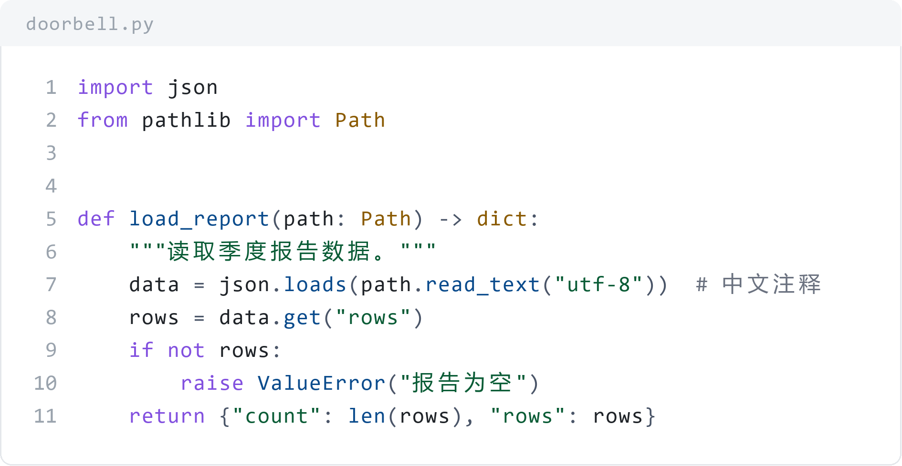
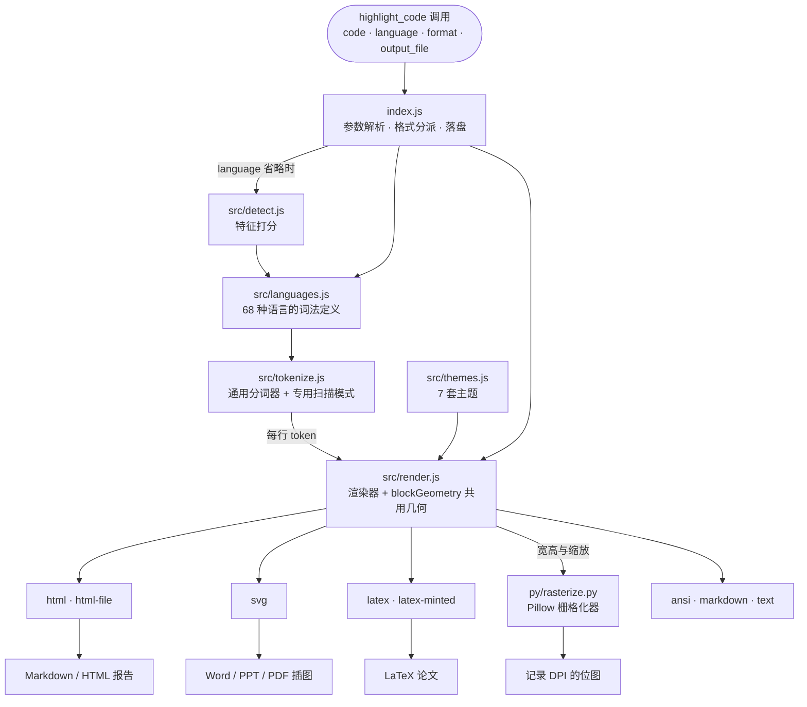
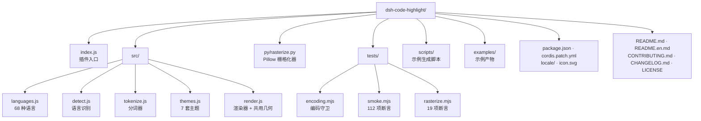

# dsh-code-highlight

[English](README.en.md) | **中文**

[](LICENSE)
[](package.json)
[](#安装)

为**报告类文档**提供代码语法高亮的 DeepSeek Harness（DSH）插件。注册一个 `highlight_code` 工具，
把代码片段渲染成带真实语法配色的产物，落到 Markdown / HTML、Word、PowerPoint、PDF 与 LaTeX 里。

<p align="center">
  
</p>

## 特性

- **68 种语言** —— 按语言名、别名或文件扩展名解析；没有给定语言时按内容自动识别，识别不出就老实按纯文本处理。
- **10 种输出** —— `html`、`html-file`、`svg`、`svg-png`、`png`、`latex`、`latex-minted`、`markdown`、`ansi`、`text`。
- **7 套主题** —— `paper-light`（文档向）、`github-dark`、`github-light`、`one-dark`、`monokai`、`solarized-light`、`solarized-dark`，另有 `auto`。
- **矢量与位图共用一套几何** —— SVG 与 PNG 由同一个布局模型产出，物理尺寸与逐格位置一致。
- **面向文档的排版参数** —— `width_in`、`dpi`、`font_size_pt`、`line_height`、`show_title`，直接产出能贴进 Word 一页宽的图。
- **直接落盘** —— 给出 `output_file` 就写文件并返回路径，不再把长文回传给模型。
- **不需要浏览器，也不需要 Office** —— PNG 由内置的 Pillow 栅格化器绘制，中文与 ASCII 在固定步进网格上对齐。
- **零运行时 npm 依赖** —— 分词器与渲染器全部自带，离线可用。

## 安装

### 作为 DSH 插件

在 DSH 会话中调用 `plugin_manager`：

```
action: install_bundle
target: <本仓库的绝对路径>
```

包内 `cordis.patch.yml` 会插入一行插件条目；安装后 `highlight_code` 对当前 profile 的所有会话可用。
修改源码后需要重启 DSH 才会加载新模块。

### 供其他项目直接引用

```bash
git clone https://github.com/scientificmaniac/dsh-code-highlight.git
cd dsh-code-highlight
npm test
```

`index.js` 导出 DSH 插件的 `apply` / `inject` / `name`；若只想用渲染能力，可直接引用 `src/` 下的模块：

```js
import { resolveLanguage } from 'dsh-code-highlight/src/languages.js';
import { tokenizeLines } from 'dsh-code-highlight/src/tokenize.js';
import { resolveTheme } from 'dsh-code-highlight/src/themes.js';
import { renderHtml } from 'dsh-code-highlight/src/render.js';
```

## 用法

| 参数 | 说明 |
| --- | --- |
| `code`（必填） | 要高亮的源码；允许整段被 Markdown 围栏包住。 |
| `language` | 语言 id、别名或扩展名，如 `python`、`py`、`ts`、`c++`、`bash`、`sql`、`latex`。省略则自动识别。 |
| `format` | 输出格式，默认 `html`。 |
| `theme` | 主题 id 或 `auto`。报告排版推荐 `paper-light`。 |
| `dark` | 仅 `theme: "auto"` 时生效的明暗偏好，默认深色。 |
| `title` | 代码块标签，通常是文件名或片段用途。 |
| `show_title` | 是否显示 `title`，默认 `true`；设 `false` 可彻底去掉文件名。 |
| `document_title` | 仅 `html-file` 用的文档标题，默认不输出，因此文件名不会变成文档标题。 |
| `line_numbers` | 是否显示行号列，默认 `true`。 |
| `start_line` | 首行行号，默认 `1`，用于片段摘录。 |
| `highlight_lines` | 需要强调的行，如 `"3,7-9"`。 |
| `font_size` | 代码字号（CSS 像素），默认 `13`。 |
| `font_size_pt` | 代码字号（磅），优先于 `font_size`；1 pt = 4/3 px。 |
| `line_height` | 行距倍数，默认 `1.5`；低于 1.3 时中文可能贴近下一行。 |
| `tab_size` | 制表符展开宽度，默认 `4`。 |
| `canvas` | 目标画布尺寸，如 `"960x540"`。设置后 `svg` 输出为整页尺寸、代码块居中缩放，可直接交给 `univer_compile_svg`。 |
| `width_in` | 物理宽度（英寸），如 `6.3`。PNG 像素宽 = `width_in × dpi`，SVG 得到等价的 `width="…in"`。 |
| `dpi` | 位图分辨率，默认 `300`；该值写入 PNG，Word 据此换算实际尺寸。 |
| `output_file` | 写入此路径并返回路径；相对路径基于会话工作区。`png` 与 `svg-png` 必填。 |
| `overwrite` | 允许覆盖已存在文件，默认 `false`。 |
| `mono_font` | 栅格化 ASCII 用的字体文件，如 `consola.ttf`。 |
| `cjk_font` | 栅格化中日韩等宽字符用的字体文件，如 `msyh.ttc`、`simsun.ttc`。 |

### 格式与落点

| `format` | 产物 | 典型落点 |
| --- | --- | --- |
| `html` | 全内联样式的 HTML 片段 | Markdown 报告、HTML 报告、邮件、可粘贴的富文本 |
| `html-file` | 完整独立 HTML 文档 | 浏览器打开、打印成 PDF |
| `svg` | 矢量代码图（可加 `width_in` 定宽） | Word / PPT / PDF 插图；也可交给 `univer_compile_svg` |
| `svg-png` | 同版式的 `.svg` + `.png` 一对文件 | 文档需要矢量图与位图兜底时 |
| `png` | Pillow 栅格化的位图，含 DPI 元数据 | 无 SVG 支持的编辑器、PDF 排版、快速预览 |
| `latex` | `listings` 环境 | `.tex` 报告（pdfLaTeX / XeLaTeX 通用，无需 shell-escape） |
| `latex-minted` | `minted` 环境 | 需要 `-shell-escape` 的 `.tex` |
| `markdown` | 围栏代码块 | 交给下游 Markdown 渲染器自行着色 |
| `ansi` | 24 位色终端文本 | 终端、日志 |
| `text` | 原样代码 | 纯文本 |

### 各报告格式的落地流程

- **Markdown / HTML** —— `format: html`，把返回片段写进报告。
- **Word（.docx）** —— `format: svg-png` + `width_in: 6.3`，插入定宽矢量图，或使用同尺寸 PNG。
- **PDF** —— `format: png` 直接排版，或 `format: latex` 由 LaTeX 排版、`html-file` 打印。
- **LaTeX / PDF 论文** —— `format: latex`（`listings`）或 `format: latex-minted`。
- **PowerPoint** —— `format: svg` + `canvas: "960x540"`，再用 `univer_compile_svg` 编译到幻灯片页。

## 栅格化：为什么中文能对齐

SVG 与 PNG 共用**固定步进网格**：一个 ASCII 单元格固定为 `0.6 × 字号`，CJK 与 emoji 占两个单元格。
排版因此只由几何决定，不依赖浏览器或 Pillow 各自的字体度量。

PNG 绘制时按字符选字体：ASCII 走等宽字体（默认 Consolas），宽字符走 CJK 字体（默认微软雅黑），
两者落在同一网格起点上——这就是「Consolas 画 ASCII + 中文字体画中文」而不让缩进走样的做法。
字体可用 `mono_font` / `cjk_font` 覆盖。

栅格化依赖 **Python 3 + Pillow**。脚本以 `stdio: ignore` 启动、诊断经临时文件回传，
因此在禁止捕获管道的受限环境里同样可用。解释器按 `python`、`py`、`python3` 依次尝试，
也可用环境变量 `DSH_CODE_HIGHLIGHT_PYTHON` 指定。

## 架构



SVG 与 PNG 是同一份几何的两个出口：`render.js` 算出逻辑宽高与缩放系数，
交给 `rasterize.py` 画位图，两者因此物理尺寸一致。

## 项目结构



## 开发

```bash
npm test                                  # 编码守卫 + 冒烟测试（无需 Python）
npm run test:raster                       # PNG 链路测试（需要 Python 3 + Pillow）
node scripts/make-doc-figure.mjs          # 生成配对的 SVG + PNG 文档插图
```

`npm test` 覆盖分词往返不变式（68 种语言 × 压力样本，输出拼回必须等于输入）、
渲染矩阵（语言 × 主题 × 格式）、语言自动识别、画布与英寸排版、`show_title` 去重与 CJK 双格宽度。
详细报告写入 `smoke-report.txt`。

## 语言一览

通用编程语言：JavaScript、TypeScript、Python、Java、Kotlin、Scala、Groovy、C、C++、C#、Go、Rust、Swift、
Ruby、PHP、Perl、Lua、R、MATLAB、Julia、Dart、Elixir、Erlang、Haskell、Clojure、Lisp、F#、Visual Basic、
Pascal、Fortran、Assembly、COBOL、Solidity、Verilog、GLSL、GDScript、Apex、Zig、Nim、OCaml、PowerShell、
Shell、Fish、Batch、Vim Script、AWK。

配置与数据：JSON、YAML、TOML、INI / properties / dotenv、XML、HTML、CSS / SCSS / LESS、Markdown、
Dockerfile、Makefile / CMake、Nginx、HTTP、Protocol Buffers、GraphQL、Terraform / HCL、Nix、Mermaid、
CSV / TSV、Diff / Patch、LaTeX、纯文本。

## 已知限制

- 一次处理一个代码片段；不做整篇报告的批量扫描。
- `width_in` 只把图缩到栏宽以内，不会把短片段放大到正好一页宽。
- HTML 中内嵌的 `<script>` / `<style>` 内容不单独着色。
- 宽字符一律按两格计算；个别终端 emoji 的实际宽度可能略有出入。
- `format: markdown` 输出的是围栏块，着色由下游 Markdown 渲染器完成，与本插件的配色无关。
- 修改插件源码后，运行中的会话仍使用已加载的模块；新代码在 DSH 重启后生效。

## 贡献

欢迎提 Issue 与 PR，详见 [CONTRIBUTING.md](CONTRIBUTING.md)。

## 许可证

[MIT](LICENSE)。
